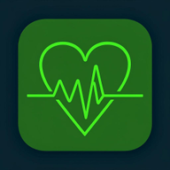
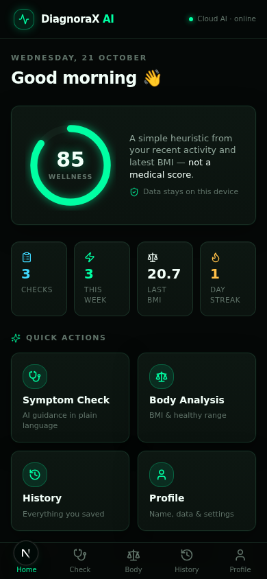
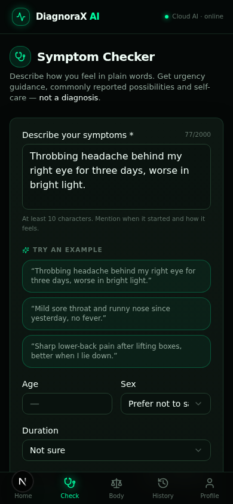
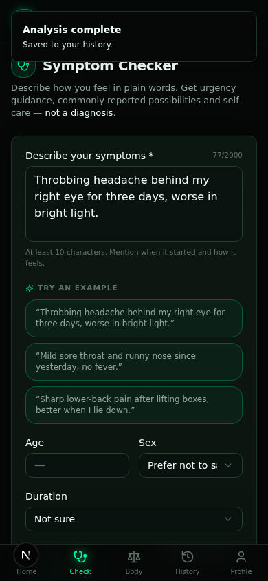
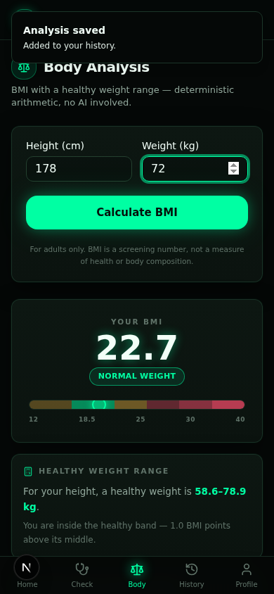
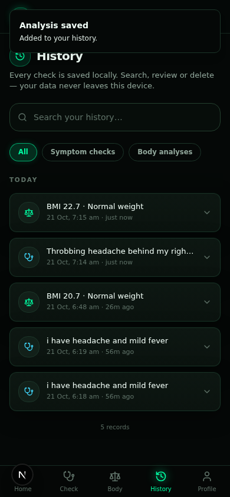
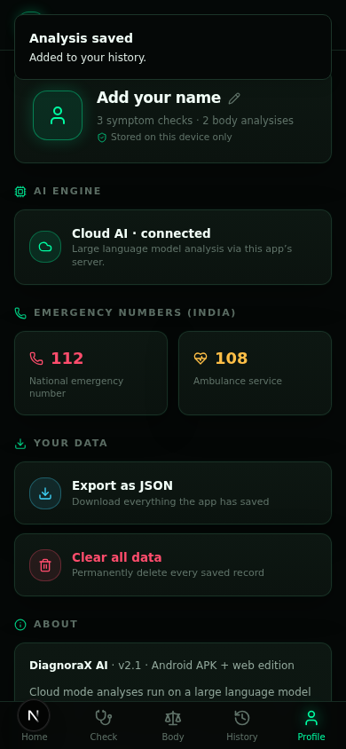
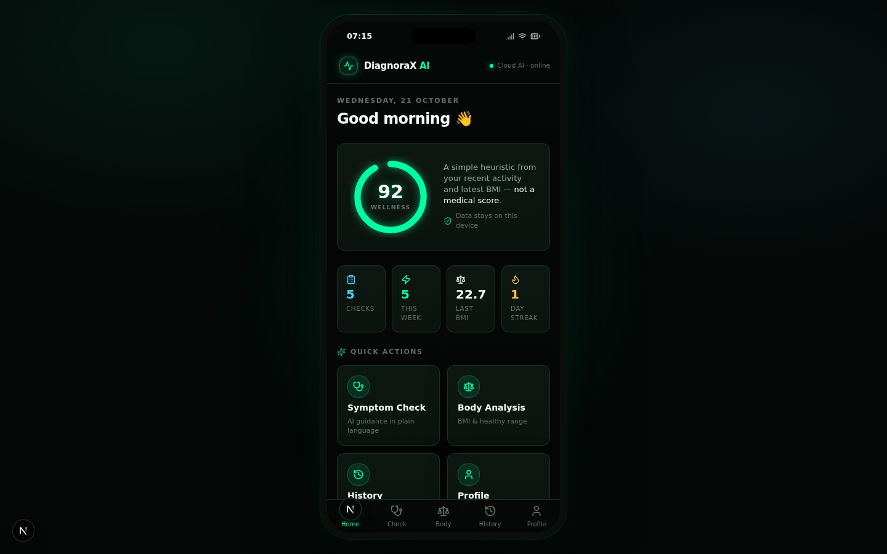

<div align="center">



# 📱 DiagnoraX AI

**Your Personal AI Health Companion**

A dark-neon mobile health app: describe symptoms in plain English, get urgency
guidance, understand your body metrics, and keep a private history — all in
your pocket. Runs as an **installable Android APK**, a **PWA**, and a web app
from one codebase.

[](https://github.com/Somesh4206/DiagnoraX-AI/releases)
[](https://github.com/Somesh4206/DiagnoraX-AI/actions/workflows/build-apk.yml)
[](https://github.com/Somesh4206/DiagnoraX-AI)
[-40D9FF?style=flat-square)](https://github.com/Somesh4206/DiagnoraX-AI/releases)

</div>

---

## 📲 Get the Android app (APK)

The easiest way to install DiagnoraX AI on your phone.

<div align="center">

| Scan to install | Direct download |
|:---:|:---:|
|  | **[⬇ Download DiagnoraX-AI.apk](https://github.com/Somesh4206/DiagnoraX-AI/releases/latest/download/DiagnoraX-AI.apk)** |
| Point your camera here | Always the latest signed build, from [Releases](https://github.com/Somesh4206/DiagnoraX-AI/releases/latest) |

</div>

**Install steps (Android 6.0+):**

1. Download `DiagnoraX-AI.apk` on your phone (or transfer it from your computer)
2. Tap the downloaded file — if asked, allow **“Install unknown apps”** for your browser/file manager
3. Open **DiagnoraX AI** from your launcher 🎉

> 💡 Every `v*` tag push rebuilds the APK automatically via
> [GitHub Actions](.github/workflows/build-apk.yml) — the download link above
> always points to the newest release.

**The APK works 100% offline:** symptom triage, BMI and history all run
on-device. Optionally, deploy the web app anywhere and connect it in
**Profile → AI engine** to enable the full cloud LLM inside the APK.

<details>
<summary>📱 Prefer installing as a PWA (no APK)?</summary>

Open the deployed web app in Chrome on Android → **⋮ → Add to Home screen**.
The app installs as a standalone fullscreen app with its own icon, using the
same UI as the APK. A `manifest.webmanifest` + service worker are included.

</details>

---

## ✨ Features

| | Feature | How it works |
|---|---|---|
| 🩺 | **AI Symptom Checker** | Plain-English description → urgency level, commonly-reported possibilities, self-care, red flags. Cloud LLM online, deterministic on-device engine offline. |
| 🚨 | **Emergency triage** | 30+ emergency phrases detected *before* any AI call, with negation handling — “no chest pain” never triggers a false alarm. |
| ⚖️ | **Body analysis** | BMI + healthy weight range + recommendations. Pure arithmetic, no AI involved. |
| 🕓 | **Private history** | Every check saved locally — search, filter, expand, delete. On the server (SQLite) online, in localStorage inside the APK. |
| 📊 | **Home dashboard** | Wellness ring, streaks, quick actions, recent activity, one-tap emergency numbers (112 / 108). |
| 🔌 | **Bring your own cloud** | Deploy the web app (e.g. Vercel) and point the APK at it for full LLM power — optional. |
| 🌓 | **Dark neon UI** | Fixed dark theme (`#050807` + neon `#00FFA3`), mobile-first at every viewport, 5-tab bottom navigation, safe-area aware. |

---

## 🖼️ Screenshots

<div align="center">
<table>
<tr>
<td></td>
<td></td>
<td></td>
</tr>
<tr>
<td></td>
<td></td>
<td></td>
</tr>
</table>



<sub>Desktop preview renders the same app inside a phone frame — it is a mobile app, not a website.</sub>
</div>

---

## 🧠 How it works — one engine, two runtimes

```
                        ┌────────────────────────────┐
   describe symptoms    │   shared engine (src/lib)  │
  ────────────────────► │  • emergency triage (RE +   │
                        │    negation scrubbing)      │
                        │  • offline knowledge base   │
                        │  • BMI arithmetic           │
                        └───────┬─────────────┬──────┘
                                │             │
              backend reachable │             │ offline (APK / no server)
                                ▼             ▼
                     Cloud AI (LLM)     On-device engine
                     + Prisma history   + localStorage history
```

- **Web build** (`next build`): Next.js 16 server, LLM analysis via
  `z-ai-web-dev-sdk`, records in SQLite (Prisma).
- **APK build** (`BUILD_TARGET=apk next build`): fully static export bundled
  by Capacitor 7 — the same triage code runs inside the WebView, zero network
  required.
- The client *probes* `/api/v1/health` and switches automatically; if a
  configured remote server becomes unreachable it falls back on-device with a
  notice.

---

## 🔒 Privacy

- No accounts, no tracking, no analytics.
- History is stored **on your device** (server DB for the web edition,
  localStorage inside the APK) and can be exported as JSON or wiped anytime
  from Profile.
- Symptom descriptions are only sent to the AI backend when cloud mode is
  active.

---

## 🛠️ Tech stack

**App**: Next.js 16 (App Router) · TypeScript · Tailwind CSS 4 · shadcn/ui ·
Framer Motion · Lucide icons · z-ai-web-dev-sdk (server-side LLM)

**Backend**: Next.js API routes (`/api/v1/*`) · Zod validation · Prisma ORM +
SQLite · CORS-enabled for remote APK use

**Mobile**: Capacitor 7 (`com.somesh.diagnorax`, SDK 23–35) · static export ·
PWA (manifest + service worker) · GitHub Actions release pipeline

---

## 🚀 Build from source

### Web app

```bash
bun install
bun run db:push        # set up the SQLite database
bun run dev            # http://localhost:3000
```

### Android APK (exactly what CI does)

```bash
bun install
rm -rf src/app/api                    # API routes can't be statically exported
BUILD_TARGET=apk bun run build:apk    # → static export in out/
bunx cap sync android                 # bundle into the Android project
cd android && ./gradlew assembleDebug # → app/build/outputs/apk/debug/
```

Or just push a `v*` tag and let
[the workflow](.github/workflows/build-apk.yml) build + publish the APK for
you.

---

## ⚠️ Medical disclaimer

DiagnoraX AI provides health **information**, not medical **advice**. It is
not a substitute for professional diagnosis or treatment. In an emergency,
**call 112 (India) / 911 / 999 immediately** — do not wait for an app.

---

## 📄 License

Released under the MIT License — see [LICENSE](LICENSE).

<div align="center">
<sub>Built with 🩺 by <a href="https://github.com/Somesh4206">Somesh M</a></sub>
</div>
